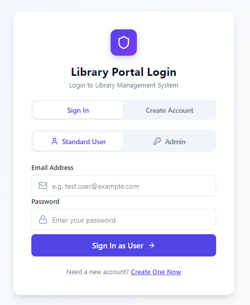

# User Management

User Management application for a Library Management System, utilising [Spring Boot](https://spring.io/projects/spring-boot), [Hibernate](https://hibernate.org/orm/), [PostgreSQL](https://www.postgresql.org/) and a [React](https://react.dev/) + [Vite](https://vite.dev/) frontend.

## Features

- Sign in and create accounts from the Library Portal
- Separate **Standard User** (email) and **Admin** (username) roles
- Passwords encrypted at rest with AES via a JPA `@Convert` attribute converter
- REST API under `/api/auth` (`/login`, `/register`) for the frontend

## Prerequisites

- Java 21
- Maven
- PostgreSQL
- Node.js and npm (for the frontend)

## Setup

You will need to create a hibernate.cfg.xml file. This will be stored in the 'resources' folder:


Example XML file:

```
<!DOCTYPE hibernate-configuration PUBLIC
        "-//Hibernate/Hibernate Configuration DTD 3.0//EN"
        " http://www.hibernate.org/dtd/hibernate-configuration-3.0.dtd">

<hibernate-configuration>
    <session-factory>
        <property name="hibernate.connection.driver_class">org.postgresql.Driver</property>
        <property name="hibernate.connection.url">jdbc:postgresql://localhost:5432/db_name</property>
        <property name="hibernate.connection.username">username</property>
        <property name="hibernate.connection.password">password</property>
        <property name="hibernate.hbm2ddl.auto">update</property>
        <property name="hibernate.show_sql">true</property>
        <mapping class="org.example.entity.User" />
        <mapping class="org.example.entity.Admin" />
    </session-factory>
</hibernate-configuration>
```

You will also need a postgresql.conf file in the same 'resources' folder, containing the key used to encrypt passwords. It must be exactly 16 characters long (AES-128):

```
encryption.key=your16charactkey
```

Install the frontend dependencies:

```
cd frontend
npm install
```


## Installation

```
git clone https://github.com/haranlakha/user-management.git
```

## Compile code

Build the backend with Maven from the project root:

```
mvn clean compile
```

Or build it in your favourite IDE e.g. [IntelliJ IDEA](https://www.jetbrains.com/idea/) (Build > Build Project).

## Run code

Run `org.example.Application` from your IDE, with the project root as the working directory.

This starts:

- the Spring Boot backend on [http://localhost:8080](http://localhost:8080)
- the React frontend dev server (`npm run dev` in the `frontend` folder) on [http://localhost:3000](http://localhost:3000), unless it is already running

The frontend server is stopped automatically when the application shuts down. To run the frontend on its own instead:

```
cd frontend
npm run dev
```

Open [http://localhost:3000](http://localhost:3000) to reach the Library Portal login page:




## Visualiser

[](https://gitdiagram.com/haranlakha/user-management?utm_source=readme&utm_medium=picture)


